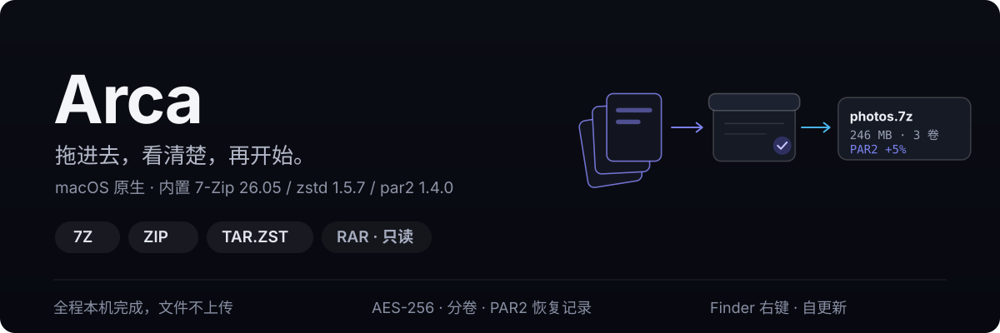
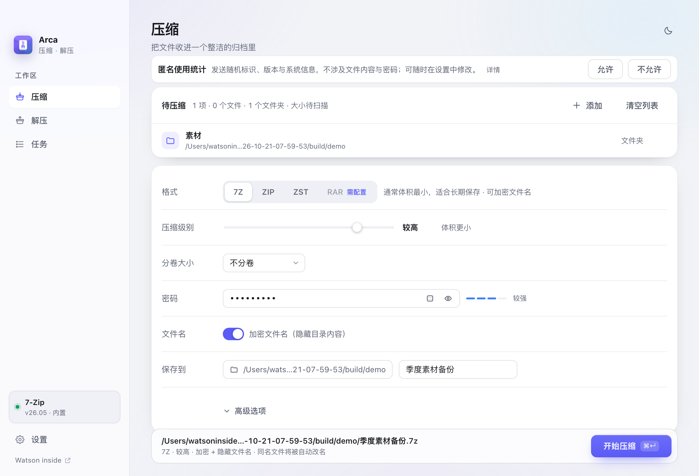
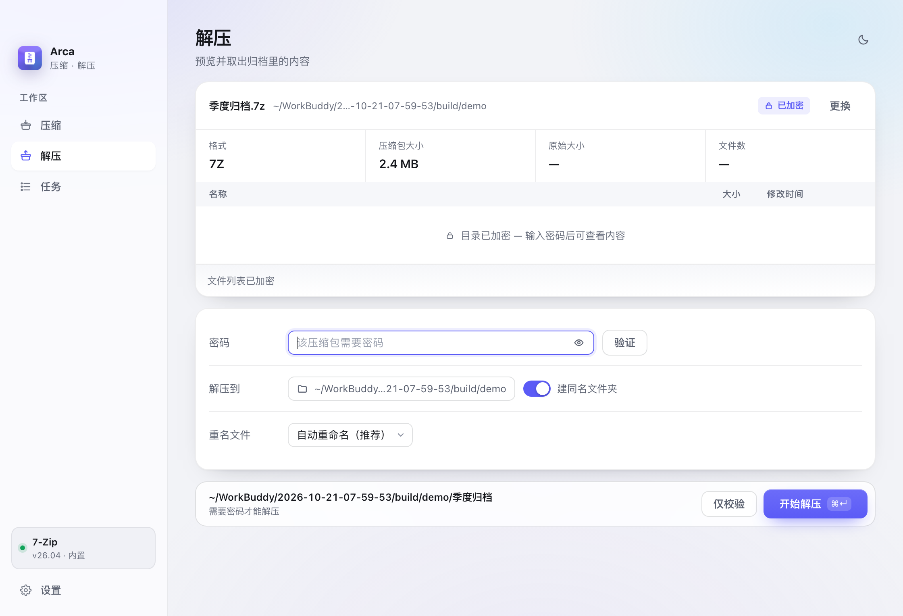
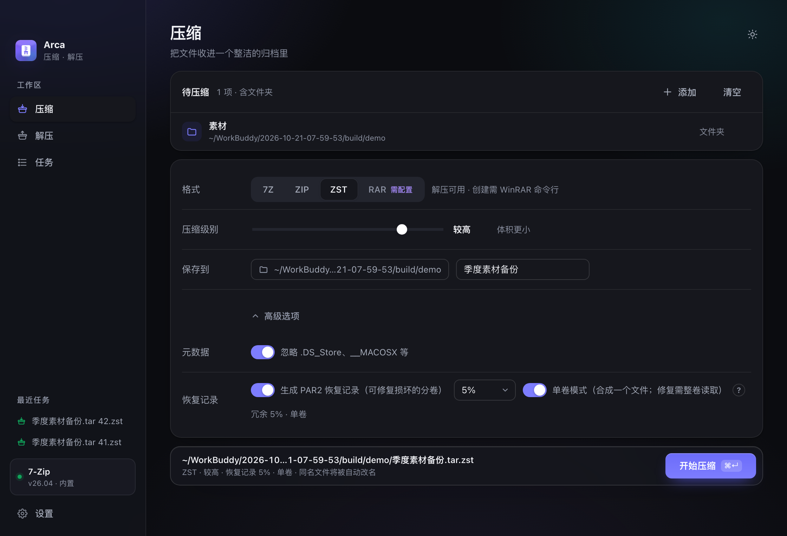
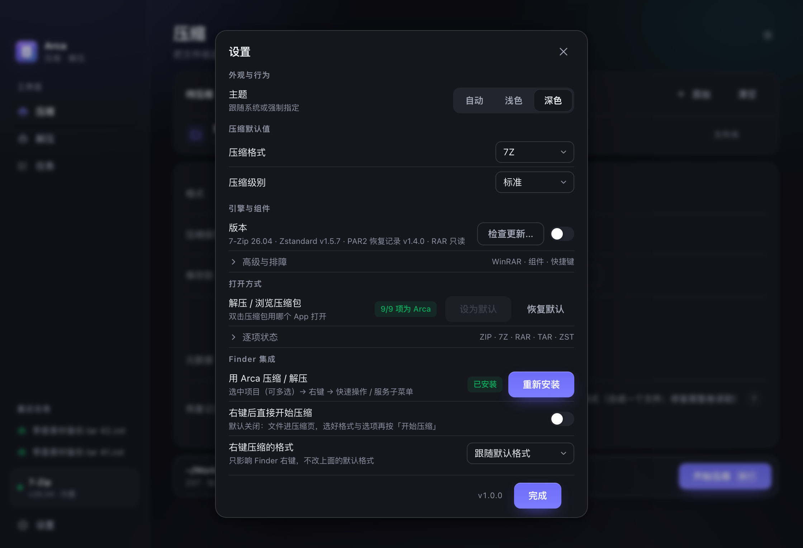

<p align="center">
  
</p>

<p align="center">
  
  
  
  
  
</p>

Arca 是一个 macOS 原生压缩 / 解压工具。它不追求"支持一切格式"，而是把四种常用格式做到位：
**看清里面有什么、选对参数、知道会发生什么**，然后才开始。

- 原生窗口（NSWindow + WKWebView），不是网页壳子；拖放、右键、默认打开方式都接进系统。
- 内置 7-Zip 26.05 / zstd 1.5.7 / par2 1.4.0，装完即用，不需要额外装命令行工具。
- 全程本机完成，文件不上传。联网只有两件事：检查更新（装不装由你决定），以及一条可关闭的匿名使用统计（见下文，首次启动时会先征求你的同意）。

真实界面是这样的（浅色与深色都跟随系统）：

<p align="center">
  
  
</p>
<p align="center">
  
  
</p>

---

<p align="center">
  
</p>

**方式一 · 下载安装包**（推荐）

到 [Releases](https://github.com/WatsonInside/arca/releases/latest) 下载最新版：

| 产物 | 文件名 | 说明 |
| --- | --- | --- |
| 磁盘映像 | `Arca-<版本>.dmg` | 打开后把 **Arca** 拖进 **Applications** |
| 安装包 | `Arca-<版本>.pkg` | 双击安装，含欢迎页与许可页 |
| 免安装 | `Arca-<版本>-mac.tar.xz` | 解包后直接运行，也是应用自更新用的格式 |

```bash
# 校验下载是否完整（摘要与 Release 里的 .sha256 一致）
shasum -a 256 ~/Downloads/Arca-1.1.0.dmg
```

**方式二 · 从源码构建**

```bash
python3 -m venv build/venv && build/venv/bin/pip install pyobjc-framework-Cocoa pyobjc-framework-WebKit
build/venv/bin/python scripts/build_thirdparty.py   # 编译 zstd / par2（universal）
build/venv/bin/python scripts/bundle.py             # 组装 release/Arca.app
build/venv/bin/python scripts/package.py            # 生成 dist/*.dmg 与 *.pkg
```

> **首次打开提示"无法验证开发者"**：应用尚未做 Apple 公证（需要付费开发者账号）。
> 右键点图标 → **打开** → 再点"打开"，或到「系统设置 → 隐私与安全性」底部点"仍要打开"。只需一次。

---

<p align="center">
  
</p>

三种进入方式，取决于你手上的东西：

1. **拖进窗口** —— 压缩页拖文件，解压页拖归档；拖进来就能看到目录树。
2. **Finder 右键** —— 选中文件（可多选）→ 快速操作 → 「用 Arca 压缩 / 解压」。
   默认先到参数页，想一键直压可在设置里打开「右键后直接开始压缩」。
3. **双击归档** —— 设置里一键把 ZIP / 7Z / RAR 等 **九种格式**交给 Arca，随时可恢复系统默认。

快捷键：`⌘1` 压缩 · `⌘2` 解压 · `⌘3` 任务 · `⌘O` 选择文件 · `⌘↵` 开始 · `Esc` 关闭面板。

| 能力 | 7Z | ZIP | TAR.ZST | RAR |
| --- | --- | --- | --- | --- |
| 创建 | ✅ lzma2 / lzma / ppmd / bzip2 | ✅ deflate / bzip2 / lzma | ✅ zstd 1–19 | ⚠️ 需 WinRAR 命令行 |
| 解压 | ✅ | ✅ | ✅（含裸 `.zst`） | ✅ RAR4 / RAR5 |
| 只解压选中条目 | ✅ | ✅ | — 单流格式 | ✅ 有引擎时 |
| 分卷 | ✅ | ✅ | — 流格式不支持 | ✅ 有引擎时 |
| AES-256 加密 | ✅ | ✅ | — 流格式不支持 | ✅ 有引擎时 |
| 隐藏文件名 | ✅ `-mhe=on` | — 格式限制 | — | ✅ 有引擎时 |
| PAR2 恢复记录 | ✅ 可选 | ✅ 可选 | ✅ 可选 | ⚠️ 需 WinRAR |

「—」不是没做完，而是格式边界：zstd 是纯字节流，没有"密码"和"分卷"的概念，
所以界面上这两行会直接不渲染，而不是显示出来再静默忽略。同理，RAR 标签会带「需配置」标记，
点它不会假装选中，而是直接把你送到设置里的 WinRAR 那一行。


几个用起来才会注意到的细节：

- **只解压需要的条目**：解压页可勾选 / 全选 / 清空，主按钮写明「解压选中 N 项」；默认全选仍是整包解压，7Z / ZIP / RAR 支持，单流 `.zst` 会明确禁用而不是偷偷整包解。
- **危险信息走行内**，不弹窗。加密归档读不到目录时，列表区直接写"目录已加密 — 输入密码后可查看内容"。
- **压缩前先算空间**，解压前也算一遍，装不下就当场说，不会写到一半失败。
- **GBK 文件名自动修复**：Windows 打的 ZIP 解出来不再是乱码。
- **任务不会被打断**：压缩或解压进行中，应用/引擎/组件更新会拒绝执行并告诉你还有几个任务在跑。
- **PAR2 是 opt-in**：3% / 5% / 10% / 15% 可选，开启时给出冗余体积预估；支持单卷模式。

---

<p align="center">
  
</p>

四个不太显然的决定，完整理由见 [`docs/ENGINEERING-NOTES.md`](docs/ENGINEERING-NOTES.md)：

| 决定 | 为什么 |
| --- | --- |
| C 启动器 `dlopen` libpython，不用 PyInstaller | bootloader 会重写自身签名，反复重签在受限环境里不稳定；手写启动器能保住每个二进制的原始签名 |
| UI 用 WKWebView，窗口用原生 | 压缩工具的价值在信息密度（进度、速度、分卷列表、密码强度），Web 层做这些更干净；窗口、文件面板、菜单仍是原生的 |
| `.tar.zst` 而不是"给 7z 加个编码器" | 7-Zip 至今没有 zstd 方法号，私有扩展等于别的工具打不开；`tar + zstd` 所有工具都认 |
| PAR2 而不是 RAR5 恢复记录 | RAR5 恢复记录是 WinRAR 私有特性（macOS 上无法创建/修复）；PAR2 是唯一跨工具的事后追加标准 |

**应用自更新**走 GitHub Releases，与引擎更新共用一套"检查 → 中文说明 → 手动确认 → 校验 → 安装"流程：

```text
启动静默检查（可在设置里关掉）
   → 有新版本：弹窗写清 当前 → 最新、发布说明
   → 点「下载并更新」才下载：进度 / 体积 / 速度
   → SHA256 必须与 sidecar 逐字相同，否则放弃
   → 替换应用包，旧包留作恢复；点「立即重启」由外部 shell 等进程退出后打开新版本
   → 新版本成功启动后清理旧包；启动失败则保留并提示人工恢复路径
```

**匿名使用统计**：为估算安装量与活跃设备，首次启动与每日首次启动各发送一条记录。不收集
文件名、路径、压缩内容或密码；为区分安装与每日活跃，会在本机保存一个随机标识，并随
App 版本、macOS 大版本与架构一起发送。首次启动时先询问（允许/不允许），未做选择前不
发送；之后可随时在「设置 → 更新来源与隐私」中修改或查看发送内容。聚合口径与对外数据
接口见 [docs/STATS-API.md](docs/STATS-API.md)。

**质量门禁**（`scripts/all_test.py` 一条命令跑完，33 个套件）：

| 套件 | 覆盖 |
| --- | --- |
| integrity 97 / selftest 39 | 引擎与组件、zstd / PAR2 全链路、Finder 集成 |
| menu 103 / acceptance 22 | 真实 UI 交互（CDP 驱动）、HTTP 行为探针 |
| keyring 53 / appupdate 41 | 钥匙串与触控 ID、应用自更新（磁盘缓存/304/stale） |
| components 15 | 7-Zip 双源与组件更新安全（T14/T15） |
| release-check 10 | 只读发布预检（资产/摘要/tar 安全/签名状态/测试 provenance） |
| stats 21 | 匿名统计客户端状态机与日志聚合口径 |
| update 25 / update-long 27 | 引擎更新：检查、跳过、稍后、安装（含真实下载） |
| partial-extract 35 / fuzz-soak 6 | 选择性解压与异常回滚、损坏/截断/穿越/低磁盘冒烟 |
| overwrite-txn 11 | 覆盖压缩的可恢复替换：staging、同卷 rename、崩溃前滚、PAR2 best-effort |
| single-instance 5 | 同 HOME 单实例锁：第二实例拒绝、不同 HOME 隔离、并发启动唯一胜者 |
| retry-plan 8 | 中断任务预填重开：安全参数白名单、journal v2 恢复、源/条目缺失契约 |
| interrupt-recovery 4 | 崩溃/中断后的状态、任务日志与回滚边界（真实 .app + 隔离 HOME） |
| jobwait 7 / menu-cleanup 9 | 任务等待时序、测试收尾策略 |
| compress-draft | 压缩草稿生命周期、取消状态与目录隔离（真实 UI→HTTP→磁盘） |

```
Arca.app/Contents/
├── MacOS/Arca                  C 启动器（dlopen libpython，进程保持 MacOS/Arca）
├── Resources/python/           内嵌 CPython 3.13 + pyobjc
└── Resources/app/
    ├── arca/engine.py          7-Zip 封装：命令、进度解析、错误文案
    ├── arca/zst.py             .tar.zst 流式压缩 / 解压
    ├── arca/par2.py            PAR2 生成、校验、修复
    ├── arca/jobs.py            任务队列：可取消、进度/ETA、历史
    ├── arca/appupdate.py       GitHub Releases 自更新
    ├── arca/server.py          本地 HTTP API（随机端口 + token）
    ├── arca/web/               前端（无框架：状态渲染 + 右键菜单）
    └── vendor/                 7zz · zstd · par2（universal + 许可证）
```

**已知限制**（完整 12 条在[工程笔记](docs/ENGINEERING-NOTES.md#已知限制)）

1. **未签名公证**：首次打开需右键"打开"一次。这也是 Touch ID 保护密码暂时不可用的原因
   （钥匙串 ACL 需要签名 entitlement）。
2. **RAR 创建**依赖本机 WinRAR 命令行；解压开箱可用。
3. **`.tar.zst` 不支持加密与分卷**：zstd 是流格式，需要保密或分卷请用 7Z / ZIP。
4. **组件更新需要本机编译器**（Xcode Command Line Tools）：zstd 与 par2 在本机编译安装。
5. **崩溃/中断不自动续传**：重开会把上次未完成的任务标成「中断」并说明产物可能不完整，
   半成品保留；没有一键重试，需要时请重新发起。

---

许可说明见 [`NOTICE`](NOTICE) 与 [`vendor/THIRD-PARTY.md`](vendor/THIRD-PARTY.md)：
应用本体 Apache-2.0，内置的 7-Zip（LGPL-2.1 + unRAR 限制）、zstd（GPL-2.0 / BSD-3-Clause）、
par2cmdline（GPL-2.0）各自随包附带许可证。

<p align="center">
  <sub>这份 README 的首图与章节标题是手写 SVG，正文与命令留在 Markdown —— 能搜索、能复制、能维护。</sub>
</p>
